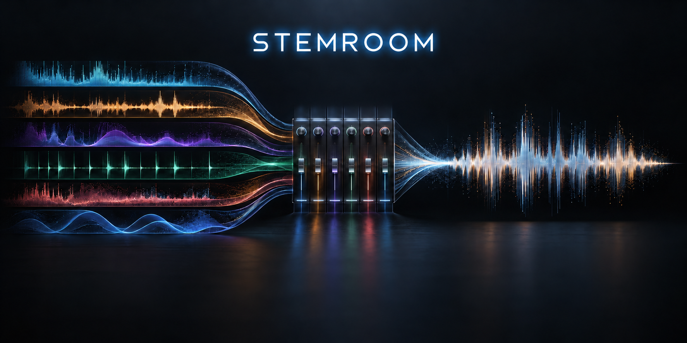

<p align="center"></p>

# Stemroom

한 곡을 **보컬 · 드럼 · 베이스 · 기타 · 피아노 · 기타 악기**의 6스템으로 나누고, 브라우저에서 바로 듣고 조절하는 로컬 퍼스트 오디오 워크스페이스입니다.

[English README](../README.md) · [아키텍처](./ARCHITECTURE.md) · [기여 가이드](../CONTRIBUTING.md)

> 기본 설정에서 오디오 파일은 `localhost`의 내 컴퓨터 API로만 전송됩니다. 외부 업로드 서비스가 아닙니다.

## 주요 기능

- MP3/WAV 입력과 안정적인 HTDemucs 6스템 분리
- 각 스템의 WAV·320kbps MP3·전체 ZIP 다운로드
- 동기화된 브라우저 재생, 스템별 볼륨·뮤트·솔로
- 영어/한국어 전환 인터페이스
- 빌드 도구가 없는 정적 웹 UI와 작은 FastAPI 엔진

## 빠른 시작

```powershell
git clone https://github.com/Gaeduck-0908/stemroom.git
cd stemroom

python -m venv apps/api/.venv
.\apps\api\.venv\Scripts\Activate.ps1
pip install torch==2.11.0 torchaudio==2.11.0 --index-url https://download.pytorch.org/whl/cu128
pip install -r apps/api/requirements.txt
.\scripts\start-stemroom.ps1
```

브라우저에서 `http://localhost:4173`을 열고 파일을 선택하면 됩니다. 기본 API 주소는 `http://localhost:8000`입니다.

## 구조

```text
apps/api/       FastAPI 기반 로컬 추론 API
apps/web/       정적 웹 앱 및 EN/KR 문구
assets/brand/   README 배너 등 브랜드 에셋
docs/           아키텍처와 로컬 문서
scripts/        실행 도우미
```

## 품질에 대한 안내

스템 분리는 확률적 추정 작업이라 믹스·편곡·마스터링·원본 상태에 따라 품질이 달라집니다. 안정형 6스템의 기타는 리듬/리드 기타를 별도로 구분하지 않습니다.

Stemroom은 [MIT License](../LICENSE)로 배포됩니다.

